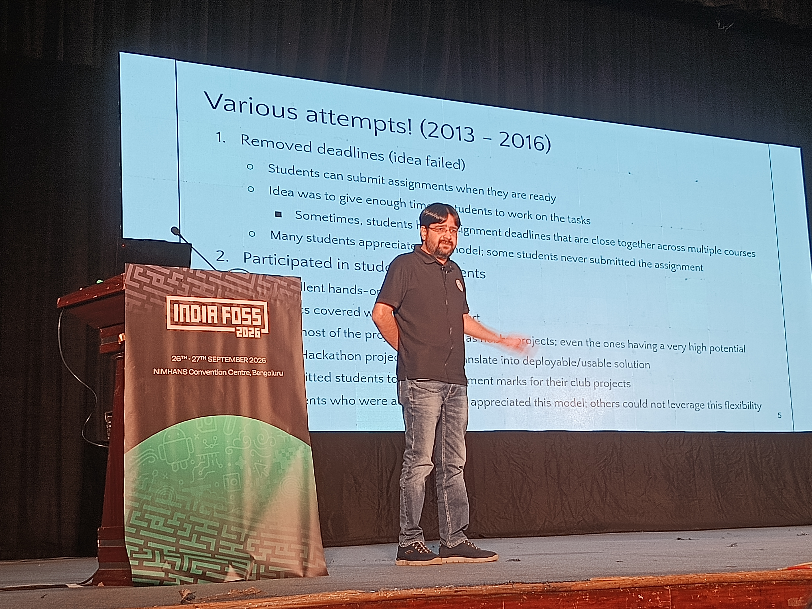

# What's New in Open Source

September – October 2026

  

  

---
layout: section
---

# Act 1: Closer to Home

---

# IndiaFOSS 2026 &amp; GB Election

  
  

    <ul class="space-y-2">
      <li><strong>Dates:</strong> 26–27 Sept 2026 at NIMHANS Convention Centre, Bengaluru</li>
      <li><strong>Governing Board:</strong> Dr. Mohit P. Tahiliani (NITK Surathkal, ns-3) elected to FOSS United GB</li>
      <li><strong>Participation:</strong> 1,131 participants, 985 votes cast, ~146 abstentions</li>
      <li><strong>Focus:</strong> Governance, funding and community infrastructure for FOSS in India</li>
    </ul>
  

---
layout: section
---

# Act 2: The Stack We Daily-Drive

---

# Linux Kernel 7.3

  
  

    <ul class="space-y-2">
      <li><strong>Released:</strong> 18 Oct 2026 (mainline)</li>
      <li><strong>Early adoption:</strong> Ubuntu 26.10 used 7.3 RC from 15 Oct 2026</li>
      <li><strong>Updates:</strong> New CPU/SoC support, filesystems, networking, graphics, security fixes</li>
      <li><strong>Impact:</strong> Better support for newer laptops, ARM/RISC-V hardware</li>
    </ul>
  

---

# Ubuntu 26.10

  
  

    <ul class="space-y-2">
      <li><strong>Released:</strong> 15 Oct 2026</li>
      <li><strong>RISC-V:</strong> Desktop images for SpacemiT K3 and QEMU, broader RISC-V support</li>
      <li><strong>AI:</strong> Myna - opt-in speech-to-text processed locally</li>
      <li><strong>Focus:</strong> Open hardware support + on-device AI</li>
    </ul>
  

---

# Dux Shell v2.0

  
  

    <ul class="space-y-2">
      <li><strong>Rebrand:</strong> DankMaterialShell → Dux Shell (20 Oct 2026)</li>
      <li><strong>Ecosystem:</strong> Dank Linux → Dux Labs, related projects renamed</li>
      <li><strong>Features:</strong> Dux Files file manager, customizable lock screen, new plugins</li>
      <li><strong>Compositors:</strong> Hyprland, MangoWC, Aqueous support expanded</li>
    </ul>
  

---

# postmarketOS → Nura

  
  

    <ul class="space-y-2">
      <li><strong>Renamed:</strong> 27 Sept 2026</li>
      <li><strong>Name:</strong> From Nuraghe, ancient stone structures of Sardinia</li>
      <li><strong>Mission:</strong> Keep devices useful longer - right to repair, device ownership, e-waste reduction</li>
    </ul>
  

---

# WSL Containers GA

  
  

    <ul class="space-y-2">
      <li><strong>Announced:</strong> 29 Sept 2026 (General Availability)</li>
      <li><strong>CLI:</strong> <code>wslc</code> / <code>container</code> alias for building/running Linux containers</li>
      <li><strong>Features:</strong> Container networking, file copy, lifecycle mgmt, event streaming, health checks</li>
      <li><strong>Note:</strong> Compose support was still on roadmap at announcement</li>
    </ul>
  

---

# Zephyr: TI &amp; Infineon

  
  

    <ul class="space-y-2">
      <li><strong>Date:</strong> 1 Oct 2026</li>
      <li><strong>Members:</strong> Texas Instruments and Infineon upgraded to Platinum in Zephyr Project</li>
      <li><strong>Impact:</strong> Better board support, drivers, tooling for RTOS/embedded/IoT</li>
    </ul>
  

---
layout: section
---

# Act 3: Under the Hood of the Web &amp; AI

---

# HTTP QUERY (RFC 10008)

  
  

    <ul class="space-y-2">
      <li><strong>Published:</strong> 10 Sept 2026 as RFC 10008</li>
      <li><strong>Properties:</strong> Safe, idempotent, cacheable; explicitly allows request body</li>
      <li><strong>Use case:</strong> Complex search queries without GET URL limits or POST ambiguity</li>
    </ul>
  

---

# Post-Quantum TLS

  
  

    <ul class="space-y-2">
      <li><strong>Progress:</strong> IETF advances ML-DSA (digital signatures) &amp; ML-KEM (key establishment) for TLS 1.3</li>
      <li><strong>Status:</strong> Documents approved as informational (protocol work in progress)</li>
      <li><strong>Goal:</strong> Prepare internet security for future quantum computing threats</li>
    </ul>
  

---

# DeepSeek DeepInfer

  
  

    <ul class="space-y-2">
      <li><strong>Released:</strong> 20 Oct 2026 under Apache 2.0</li>
      <li><strong>What it is:</strong> Production inference engine powering DeepSeek models, built on vLLM</li>
      <li><strong>Hardware:</strong> Supports NVIDIA CUDA and Huawei Ascend</li>
      <li><strong>Impact:</strong> Opens internal serving stack to community</li>
    </ul>
  

---

# Google Mantis

  
  

    <ul class="space-y-2">
      <li><strong>Released:</strong> 2 Sept 2026 as open-source framework</li>
      <li><strong>Approach:</strong> AI agents discover, reproduce, triage and help patch bugs</li>
      <li><strong>Advantage:</strong> Sandboxed reproduction to reduce false positives from AI reports</li>
    </ul>
  

---
layout: section
---

# Act 4: Open Source Beyond Code

---

# UN System Data Commons

  
  

    <ul class="space-y-2">
      <li><strong>Launched:</strong> 17 Sept 2026</li>
      <li><strong>Adoption:</strong> 26 UN entities committed, 17 connected at launch</li>
      <li><strong>Goal:</strong> Make UN system data easier to discover, access and reuse</li>
    </ul>
  

---

# Data Commons SDMX 3.0

  
  

    <ul class="space-y-2">
      <li><strong>Launched:</strong> 23 Sept 2026</li>
      <li><strong>Standard:</strong> SDMX 3.0 API for discovering and retrieving statistical observations</li>
      <li><strong>Benefit:</strong> Standardized interfaces for public statistics without custom parsers</li>
    </ul>
  

---

# OpenStreetMap Milestones

  
  

    <ul class="space-y-2">
      <li><strong>Milestone:</strong> Over 115 million mapped names under ODbL</li>
      <li><strong>Update:</strong> New localized vector tile layer on openstreetmap.org</li>
      <li><strong>Governance:</strong> 20th OSM Foundation AGM and board election on 17 Oct 2026</li>
    </ul>
  

---

# LF OpenGrid

  
  

    <ul class="space-y-2">
      <li><strong>Launched:</strong> 7 Oct 2026 by Linux Foundation</li>
      <li><strong>Scope:</strong> Shared data, tools, APIs and interoperability standards for electricity-grid planning</li>
      <li><strong>Goal:</strong> Make grid planning more accessible and accelerate energy infrastructure deployment</li>
    </ul>
  

---
layout: section
---

# Act 5: Patch Your Servers &amp; Protect Maintainers

---

# PHP2Shell RCEs

  
  

    <ul class="space-y-2">
      <li><strong>CVEs:</strong> CVE-2026-109618, CVE-2026-109619 (CVSS 9.2)</li>
      <li><strong>Impact:</strong> Unauthenticated RCE via memory corruption/stale global state; mod_php especially at risk</li>
      <li><strong>Patches:</strong> PHP 8.5.12, 8.4.27, 8.3.36, 8.2.35</li>
      <li><strong>Follow-up:</strong> CVE-2026-115560 reported 23 Oct; no fix yet - mitigate by disabling <code>session.upload_progress.enabled</code></li>
    </ul>
  

---

# Node.js Security Update

  
  

    <ul class="space-y-2">
      <li><strong>Released:</strong> 21 Oct 2026</li>
      <li><strong>Critical:</strong> CVE-2026-111497 - out-of-bounds write in bundled Brotli decoder (RCE risk)</li>
      <li><strong>Others:</strong> DNS NUL-byte truncation, TLS hostname verification bypass, crypto random cache reuse across snapshots</li>
      <li><strong>Patches:</strong> Node.js 22.23.4, 24.22.1, 26.12.1</li>
    </ul>
  

---

# IFPI vs yt-dlp

  
  

    <ul class="space-y-2">
      <li><strong>Request:</strong> IFPI asked EC to include yt-dlp in 2027 Counterfeit &amp; Piracy Watch List (stream-ripping)</li>
      <li><strong>Status:</strong> Request, not a ban - watch list expected Q2 2027</li>
      <li><strong>Debate:</strong> Dual-use software - should responsibility fall on developers/users/platforms/providers?</li>
    </ul>
  

